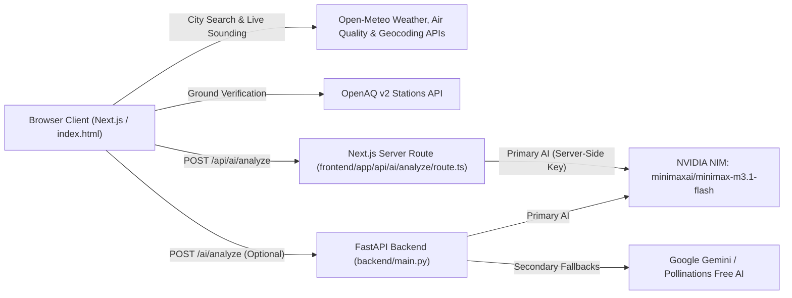

<div align="center">
  
  <h1>Aetheris — Hyper-Local Atmospheric Reconnaissance &amp; Air Quality Intelligence</h1>
  <p>
    <strong>Real-time Planetary Boundary Layer soundings, 72-hour thermal inversion forecasting, multi-point regional grids, and token-restricted AI mitigation planning.</strong>
  </p>
  <p>
    
    
    
    
  </p>
</div>

---

## Table of Contents

1. [Overview](#overview)
2. [System Architecture](#system-architecture)
3. [Detailed Parameter Reference](#detailed-parameter-reference)
   - [Top Atmospheric KPIs](#1-top-atmospheric-kpis)
   - [Live 6-Pollutant Concentration Table](#2-live-6-pollutant-concentration-table)
   - [Basin Vertical Stratification &amp; 72-Hour Profile](#3-basin-vertical-stratification--72-hour-profile)
   - [Community Smog Shield Network (3-Point Grid)](#4-community-smog-shield-network-3-point-grid)
   - [AI Air Nav &amp; Token-Consumption Barriers](#5-ai-air-nav--token-consumption-barriers)
   - [Action Workflows &amp; Impact Metrics](#6-action-workflows--impact-metrics)
4. [Project Structure](#project-structure)
5. [Environment Configuration](#environment-configuration)
6. [Getting Started](#getting-started)
7. [API Endpoints Reference](#api-endpoints-reference)
8. [Security &amp; Secret Hygiene](#security--secret-hygiene)

---

## Overview

**Aetheris** is an environmental telemetry and respiratory defense platform built to monitor **thermal inversions**, **surface particulate trapping**, and **72-hour dispersion windows** anywhere in the world.

It ships in two synchronized interfaces:
- **Next.js 14 App Router Dashboard** (`frontend/`) — full multi-page React + TypeScript application with server-side AI API routes (`/api/ai/analyze`).
- **Standalone Zero-Build Dashboard** (`index.html`) — self-contained Tailwind + Vanilla JS single-file interface for instant local or static deployment.

---

## System Architecture



---

## Detailed Parameter Reference

### 1. Top Atmospheric KPIs

| Parameter | Unit | Data Source / Formula | What It Means &amp; Operational Thresholds |
| :--- | :--- | :--- | :--- |
| **Trapping Ceiling** | `m MSL` | Open-Meteo `hourly.boundary_layer_height[0]` (clamped `>= 220m`) | **Planetary Boundary Layer (PBL) height** above mean sea level. Acts as an invisible atmospheric lid. Below **`650m MSL`**, warm air aloft caps cold surface air (`Compression Lid Active`), trapping smoke and exhaust near the ground. Above **`750m MSL`**, vertical mixing dilutes pollutants (`Expanded Vent`). |
| **Stagnation Shear** | `m/s` | Open-Meteo `current.wind_speed_10m / 3.6` | **Lateral 10m wind speed** driving horizontal dispersion. Speeds **`< 1.5 m/s`** indicate atmospheric stagnation (`Low Shear`), locking emissions in place. Speeds **`>= 1.5 m/s`** promote active dispersion. |
| **Speciation Mix** | `%` | `biomassPct = clamp(30..84, round((PM2.5 * 1.2) / (PM2.5 + NO2 + 6.0) * 100))`, `mobilePct = 100 - biomassPct` | Estimates the **pollution source split** between **Biomass / Solid Combustion** (wood, crop residue, dust) and **Mobile $\text{NO}_x$ &amp; Soot** (diesel/petrol traffic exhaust). |
| **Predicted Flush** | `+hours` | First future hour `i >= 2` in 72h Open-Meteo sounding where `BLH > 750m` OR `wind > 3.8 m/s` | Countdown in hours until an incoming weather front or strong boundary-layer expansion breaks the thermal inversion and scours the basin. |
| **AQI** | `US EPA` | Open-Meteo `current.us_aqi` (verified/recomputed from OpenAQ `pm25` breakpoints when available) | Standardized **US EPA Air Quality Index** (`0–50` Good, `51–100` Moderate, `101–150` Unhealthy for Sensitive Groups, `151–200` Unhealthy, `201–300` Very Unhealthy, `301+` Hazardous). Card background, border, and badge colors adapt dynamically. |
| **Bench Ridge AQI** | `AQI` &amp; `µg/m³` | `ridgeDecay = exp(-max(0, (640 - BLH) / 480))`, `benchPm25 = max(2.4, pm25 * min(0.35, ridgeDecay))`, `benchAqi = max(10, round(benchPm25 * 2.1))` | Models **clean-air conditions at elevated foothill/ridge altitudes** situated above the trapping ceiling, demonstrating the vertical concentration drop compared to the valley floor. |

---

### 2. Live 6-Pollutant Concentration Table

Displayed in the **Air pollutants in `<City>`** section using live **Open-Meteo Air Quality** (`current=us_aqi,pm10,pm2_5,ozone,nitrogen_dioxide,sulphur_dioxide,carbon_monoxide`) and **OpenAQ v2** verification:

| Pollutant | Symbol | Unit | Description | Good | Moderate | Unhealthy (Sens.) | Unhealthy | Very Unhealthy |
| :--- | :---: | :---: | :--- | :---: | :---: | :---: | :---: | :---: |
| **Fine Particles** | $\text{PM}_{2.5}$ | `µg/m³` | Inhalable particles `<= 2.5 µm` that penetrate deep into alveoli and bloodstream. | `<= 12` | `<= 35.4` | `<= 55.4` | `<= 150.4` | `> 150.4` |
| **Coarse Particles** | $\text{PM}_{10}$ | `µg/m³` | Dust, pollen, construction, and road particulates `<= 10 µm`. | `<= 54` | `<= 154` | `<= 254` | `<= 354` | `> 354` |
| **Ozone** | $\text{O}_3$ | `µg/m³` | Ground-level photochemical oxidant formed by sunlight + $\text{NO}_x$ + VOCs. | `<= 100` | `<= 160` | `<= 215` | `<= 265` | `> 265` |
| **Nitrogen Dioxide** | $\text{NO}_2$ | `µg/m³` | Primary traffic and combustion gas; key precursor to urban smog and soot. | `<= 50` | `<= 100` | `<= 200` | `<= 400` | `> 400` |
| **Sulphur Dioxide** | $\text{SO}_2$ | `µg/m³` | Industrial and fossil-fuel sulfur combustion gas causing airway irritation. | `<= 40` | `<= 80` | `<= 380` | `<= 800` | `> 800` |
| **Carbon Monoxide** | $\text{CO}$ | `µg/m³` | Incomplete combustion gas from vehicles and heating appliances. | `<= 4400` | `<= 9400` | `<= 12400` | `<= 15400` | `> 15400` |

---

### 3. Basin Vertical Stratification &amp; 72-Hour Profile

- **Basin Vertical Stratification Profile (Map Graph)**:
  - Visualizes the **Valley Floor Smog Trap** vs. **Elevated Ridge (Above Lid)** alongside the live trapping ceiling (`m MSL`).
  - **Interactive Hover Legend**: Moving the cursor over the upper or lower altitude zone opens a floating legend card showing Valley Floor $\text{PM}_{2.5}$, Ridge Clean Air $\text{PM}_{2.5}$, Trapping Lid (`m MSL`), and percentage soot reduction.
- **72-Hour Smog &amp; Thermal Inversion Profile**:
  - Plots 72 hourly data points from Open-Meteo (`Basin Floor PM2.5`, `Bench Ridgeline PM2.5`, and `Inversion Lid Altitude`).
  - **Two-Tier Non-Overlapping X-Axis**: Hourly ticks (`00:00`, `06:00`, `12:00`, `18:00`, `24:00`) on row 1 and dynamic real calendar weekdays (`TODAY`, `TOMORROW`, `DAY 3`) on row 2.
  - **Y-Axis Time Progression**: Forecast horizon markers (`0h (Now)` to `+72 hrs`) on the left and concentration scale (`0µg`–`200µg`) on the right.
  - **Dynamic `NOW` Pointer**: Automatically tracks your exact local clock position across Day 1 and updates every 30 seconds.
  - **Interactive Hover Crosshair**: Displays exact forecast offset (`+Xh`), timestamp, $\text{PM}_{2.5}$, Ridge $\text{PM}_{2.5}$, Inversion Lid (`m MSL`), and **Vent Window** / **Flush Scour** badges.
  - **Workable HVAC Purge Scheduler**: Arms/persists scheduled fresh-air exchange during the midday **Solar Expansion Window (`13:30–15:30`)**.

---

### 4. Community Smog Shield Network (3-Point Grid)

Instead of static placeholder stations, the network queries **3 live surrounding Open-Meteo Air Quality grid coordinates** in a single batch request:

| Grid Node | Coordinate Offset | Approximate Radius | Live Metrics &amp; Actions |
| :--- | :--- | :--- | :--- |
| **North Sector Grid** | `lat + 0.12°, lon` | `~13 km North` | Live `us_aqi`, `pm2_5`, `pm10`, `no2` • `Inspect Grid` (focuses dashboard) or `Dispatch Inspector` (when AQI `&gt; 150`) |
| **East Sector Grid** | `lat, lon + 0.14°` | `~13 km East` | Live `us_aqi`, `pm2_5`, `pm10`, `no2` • `Inspect Grid` or `Dispatch Inspector` |
| **South-West Sector Grid** | `lat - 0.12°, lon - 0.10°` | `~16 km SW` | Live `us_aqi`, `pm2_5`, `pm10`, `no2` • `Inspect Grid` or `Dispatch Inspector` |

---

### 5. AI Air Nav &amp; Token-Consumption Barriers

Powered by **NVIDIA NIM (`minimaxai/minimax-m3.1-flash`)** via server-side routes (`/api/ai/analyze` in Next.js and `/ai/analyze` in FastAPI), featuring strict token-conservation and accuracy guardrails:

| Guardrail / Setting | Value | Purpose |
| :--- | :--- | :--- |
| **Model** | `minimaxai/minimax-m3.1-flash` | Fast reasoning model via `integrate.api.nvidia.com/v1/chat/completions` |
| **Temperature / Top-P / Seed** | `0.15` / `0.95` / `0` | Deterministic, data-grounded output citing only live telemetry numbers |
| **Output Token Cap** | `1200` tokens (NVIDIA) / `260` (Gemini) | Down from `16384` to prevent verbose token waste while allowing MiniMax reasoning + JSON |
| **Query Length Cap** | `220` characters | Prevents prompt-bloat token spikes |
| **TTL Response Cache** | `10 minutes` (Server) + Session Cache (Client) | Keyed by `(city, AQI rounded to nearest 5, query)` — repeat queries use **0 tokens** |
| **Rate Limit &amp; Cooldown** | `3s` cooldown • `10 req/min` (`429`) • `12 calls/session` | Prevents accidental spam and quota exhaustion |
| **Multi-Stage Loading UI** | Animated neural-ring spinner + progress bar | Stays visible while gathering telemetry and running AI synthesis; hides automatically when ready |

---

### 6. Action Workflows &amp; Impact Metrics

- **Action Workflows &amp; Mitigation Protocols** (`/workflows`): Dynamically calibrates **Commute &amp; School**, **Indoor Cooking &amp; Kitchen Hygiene**, and **Work &amp; Fitness** recommendations using live `aqi`, `pm25`, `no2`, `benchRidgePm25`, `trappingCeilingMsl`, `stagnationShear`, and `predictedFlushHours`.
- **Impact Metrics** (`/metrics`): Calculates **Daily Toxin Interception** (`((outdoorPm25 - ridgePm25) * 14.4 m³/day) / 1000` in `mg PM2.5/day`), 30-day projection, live **Respiratory Risk Index**, and **3-Point Regional Grid Coverage**, with one-click **Export Live Audit** (`.json` download).
- *(Note: **Pricing &amp; Community** is currently disabled and hidden.)*

---

## Project Structure

```text
air quality/
├── index.html                          # Standalone zero-build dashboard
├── README.md                           # Full project & parameter documentation
├── backend/
│   ├── .env                            # Server-side secrets (never committed)
│   ├── .env.example                    # Safe environment template
│   ├── main.py                         # FastAPI entry point
│   ├── models.py                       # Pure-Python data & request/response schemas
│   ├── database.py                     # SQLite database helpers
│   ├── auth.py                         # JWT auth helpers
│   ├── requirements.txt                # Python dependencies
│   └── routers/
│       ├── ai.py                       # NVIDIA NIM / Gemini / Pollinations AI router + /ai/health
│       ├── air_quality.py              # Open-Meteo & OpenAQ telemetry endpoints
│       └── auth.py                     # Auth endpoints
└── frontend/
    ├── public/
    │   └── favicon.ico                 # Browser tab & README icon
    ├── package.json                    # Next.js 14 + React 18 + Tailwind CSS
    ├── lib/
    │   └── api.ts                      # Live Open-Meteo & OpenAQ client + 3-point grid
    ├── components/
    │   ├── Navbar.tsx                  # Top navigation bar
    │   └── AlertBanner.tsx             # Inversion alert banner
    └── app/
        ├── layout.tsx                  # Root metadata & favicon config
        ├── api/ai/analyze/route.ts     # Next.js server-side NVIDIA AI route
        └── (dashboard)/
            ├── forecast/page.tsx       # Smog Forecast & 72h Profile
            ├── ai-nav/page.tsx         # AI Air Nav Copilot
            ├── workflows/page.tsx      # Live Action Workflows
            ├── metrics/page.tsx        # Live Impact Metrics & JSON Export
            └── pricing/page.tsx        # Disabled (redirects to /forecast)
```

---

## Environment Configuration

Create or update `backend/.env` (see `backend/.env.example`):

```env
DATABASE_URL=sqlite:///./aetheris.db
SECRET_KEY=your_64_char_secret_key
ALGORITHM=HS256
ACCESS_TOKEN_EXPIRE_MINUTES=60
REFRESH_TOKEN_EXPIRE_DAYS=7
WAQI_TOKEN=demo
DEBUG=true
NVIDIA_API_KEY=nvapi-xxxxxxxxxxxxxxxxxxxx
NVIDIA_MODEL=minimaxai/minimax-m3.1-flash
```

---

## Getting Started

### Option 1: Next.js Full-Stack App (Recommended)
```bash
cd frontend
npm install
npm run dev
```
Open `http://localhost:3000` — the built-in `/api/ai/analyze` server route automatically reads `NVIDIA_API_KEY` from `backend/.env`.

### Option 2: Optional FastAPI Backend
```bash
cd backend
pip install -r requirements.txt
uvicorn main:app --reload --port 8000
```

### Option 3: Standalone HTML Dashboard
Open `index.html` directly in any modern browser for instant live Open-Meteo &amp; OpenAQ monitoring.

---

## API Endpoints Reference

| Service | Method &amp; Path | Purpose |
| :--- | :--- | :--- |
| **Next.js Server** | `POST /api/ai/analyze` | Server-side NVIDIA `minimaxai/minimax-m3.1-flash` synthesis with caching &amp; rate limits |
| **FastAPI AI** | `GET /ai/health` | Reports active model, `nvidia_configured`, token caps, and cache count |
| **FastAPI AI** | `POST /ai/analyze` | Grounded AI synthesis (NVIDIA NIM primary, Gemini / Pollinations fallback) |
| **FastAPI AQ** | `GET /aq/current` | Live city air quality, boundary layer height, and ridge decay |
| **FastAPI AQ** | `GET /aq/forecast` | 72-hour hourly $\text{PM}_{2.5}$ &amp; boundary layer forecast |

---

## Security &amp; Secret Hygiene

- All API keys (`NVIDIA_API_KEY`, `GEMINI_API_KEY`, `SECRET_KEY`) reside exclusively in `backend/.env` and are read **only** on the server (`backend/routers/ai.py` and `frontend/app/api/ai/analyze/route.ts`).
- Zero API keys are hardcoded or exposed in client-side JavaScript or HTML files.
